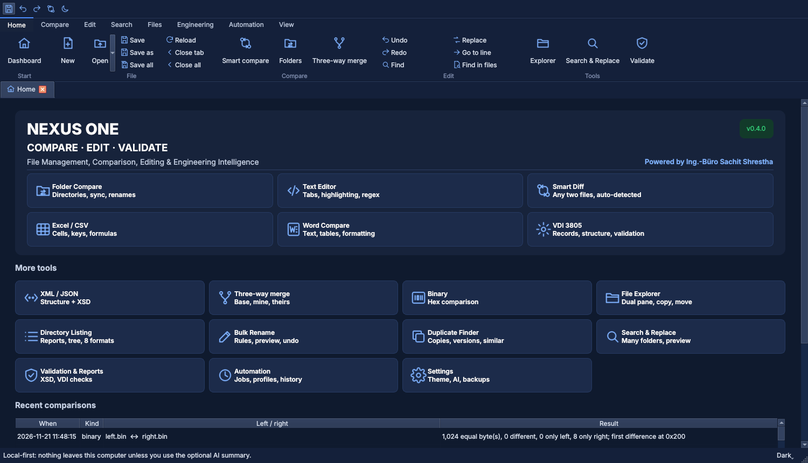
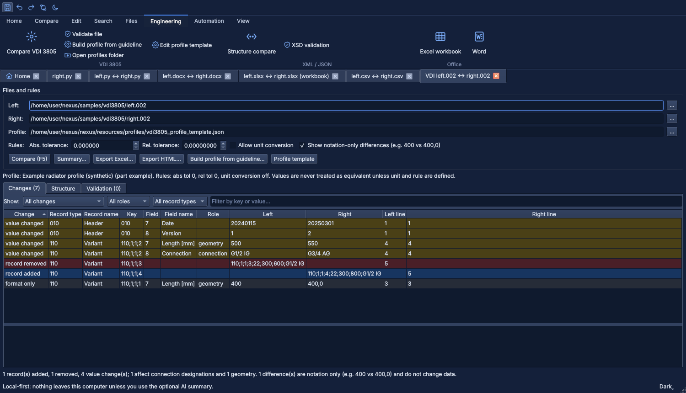
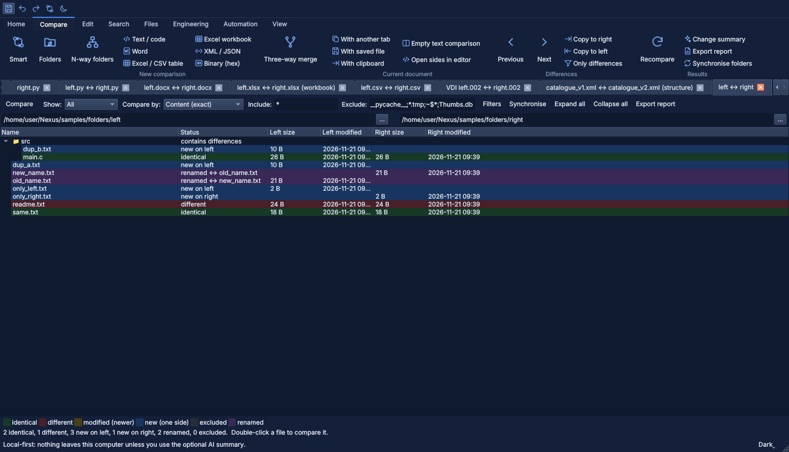
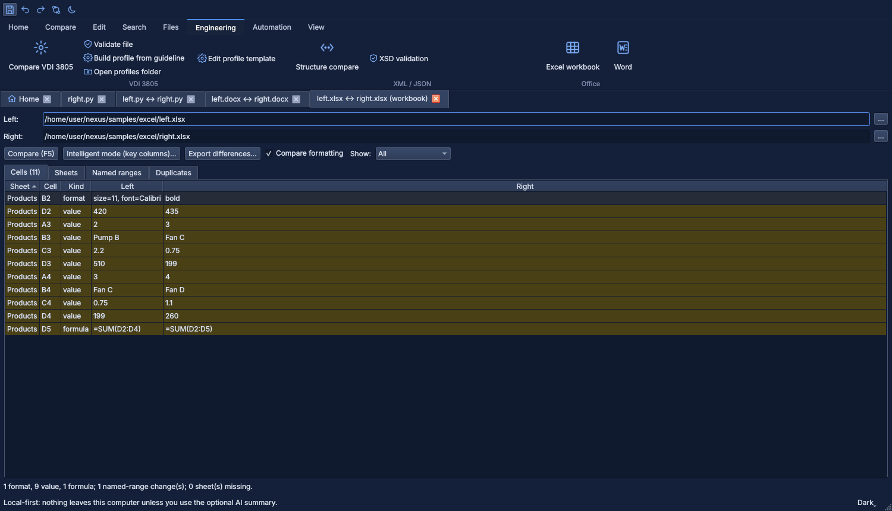
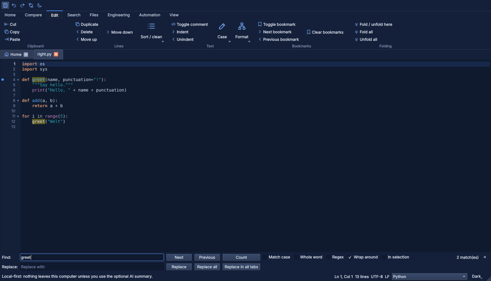
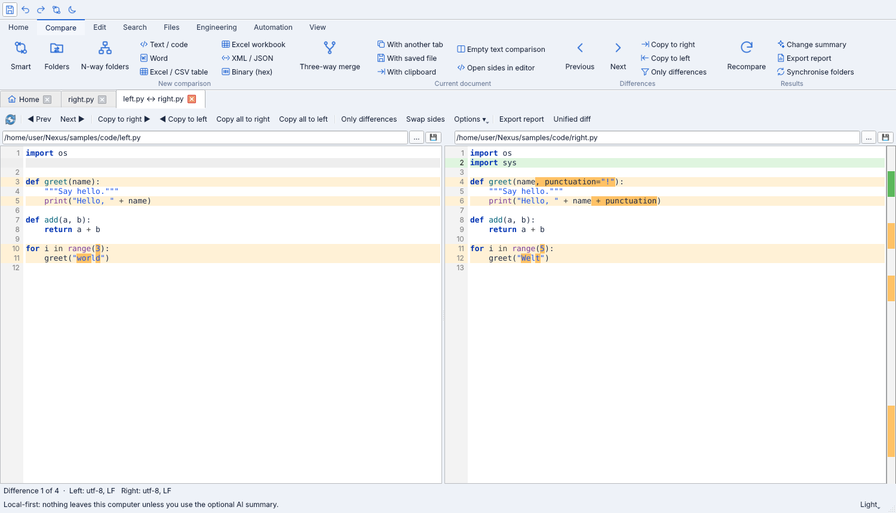

# NEXUS ONE 0.4

**COMPARE · EDIT · VALIDATE** – file management, comparison, editing and engineering intelligence for Windows 10/11.

NEXUS ONE (formerly Nexus Compare & Editor) is one desktop app with a ribbon interface that does all of the following:

* **Folder compare.** Two-way and N-way compare with checksums, rename detection, regex/size/date filters, colour-coded status and sync with preview, backups and an audit log.
* **Code editor.** Tabs, 500+ languages, bookmarks, folding, split view, encodings, find in files and crash recovery.
* **Intelligent file compare.** Text (char/word), Word (incl. formatting), Excel (cells, formulas, formats, named ranges, renamed sheets, key columns), CSV, XML/JSON structure plus XSD, binary/hex and three-way merge.
* **VDI 3805 engineering compare (priority).** Reads real catalogues (decimal sub-records, hierarchical keys, 150k+ records), builds part profiles straight from the VDI guideline documents, validates field formats and structure, and classifies each difference as value / notation-only / equivalent.
* **Search & replace across folders.** Preview, history, backups and export.
* **Bulk rename.** Ordered rules, CSV/Excel rename lists, tokens, files and folders, full preview, automatic rollback, undo history and profiles.
* **Directory listing & reports.** Filters, 16 columns, grouping, statistics, tree diagram, export to Excel, CSV, TXT, HTML, PDF, Markdown, XML and JSON, print preview and templates.
* **Duplicate Finder.** Identical files, renamed copies, near-duplicate text and version series. Never deletes anything.
* **File tools.** Dual-pane explorer, attributes and timestamps.
* **Automation.** JSON jobs, `--job` CLI, Windows Task Scheduler and an SQLite history.

Everything runs locally. The optional AI change summary is off by default and asks before it sends anything.



| | |
|---|---|
|  |  |
|  |  |

Status per module, known gaps and the development log: [docs/nexus-one-status.md](docs/nexus-one-status.md). Release notes: [CHANGELOG.md](CHANGELOG.md).

## Quick start
* **Windows, from source:** double-click `run_from_source.bat`. It needs Python 3.10+.
* **Light and dark:** View → Theme switches between Light, Dark (navy) and Follow Windows. Ctrl+Shift+D toggles, and the theme name in the status bar opens the same menu.



* **Download:** the Windows installer `Nexus-<version>-setup.exe` is on the [Releases page](https://github.com/sachitss/nexus/releases). It is not code-signed yet, so Windows SmartScreen may ask you to confirm (More info → Run anyway).
* **Windows app:** run `build_windows.bat` to build `dist\Nexus\Nexus.exe`, then compile `installer\nexus.iss` with Inno Setup to get `Nexus-0.4.0-setup.exe`. Pushing to GitHub builds both through `.github/workflows/build-windows.yml`. Publishing a release (tag `v<version>`) on GitHub builds again and attaches the installer to it.
* **Any OS:** `pip install -r requirements.txt` then `python -m nexus`.

```
python -m nexus left.xlsx right.xlsx -c        # open a comparison
python -m nexus --diff left.002 right.002      # console diff (VDI 3805, tables, folders, text)
python -m nexus --job daily.json               # run an automation job (exit 0/1/2)
python -m nexus --build-profile VDI_3805_1.docx VDI_3805_06.docx   # VDI part profile from the guidelines
```

## Documentation
* [User guide](docs/user-guide.md)
* [Research & competitive analysis, feature matrix, VDI 3805 findings](docs/research.md)
* [Architecture, stack evaluation and licensing](docs/architecture.md)
* [Feature specification, status and roadmap](docs/feature-spec-and-roadmap.md)
* [Developer & maintenance guide](docs/developer-guide.md)

## Tests
`python -m pytest -q tests` runs 54 tests covering the engines plus offscreen GUI smoke tests. `python tests/make_samples.py` regenerates the samples in `samples/`, and `python tests/screenshots.py screenshots` renders every view.

## Licence notes
Nexus uses Qt through PySide6 (LGPL-3.0, dynamically linked in the one-folder build). The other dependencies are permissive (MIT/BSD). See `docs/architecture.md`. Nexus is original work. Third-party products named in the research were used only as feature references and were not run, decompiled or copied.

---


**Powered by Ing.-Büro Sachit Shrestha** · Team Nepal Solutions  
© 2026 Ing.-Büro Sachit Shrestha. Project and releases: https://github.com/sachitss/nexus

